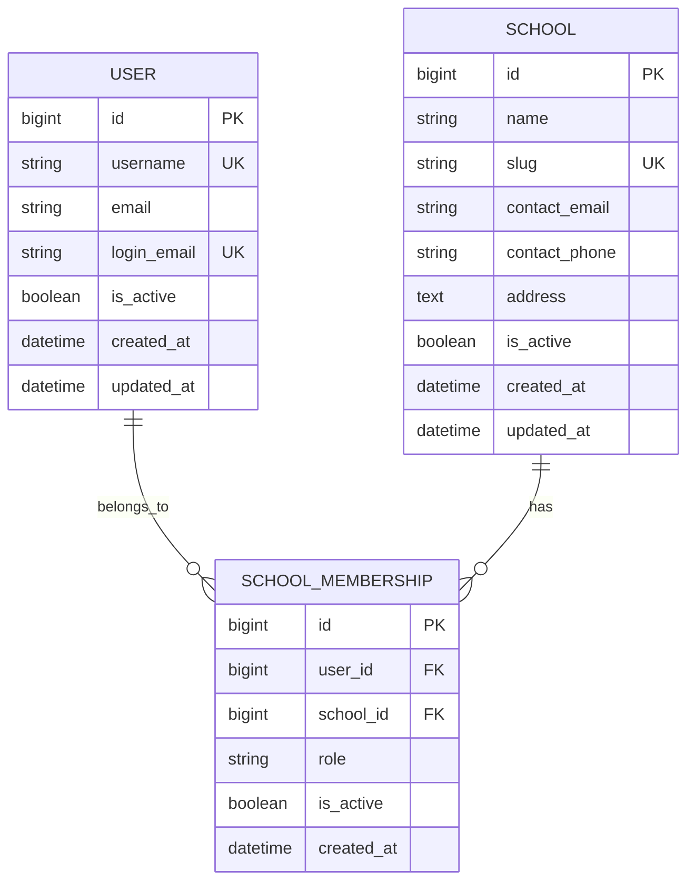

# Module 1 database schema

This is the Module 1 tenant foundation. Django migrations are the executable source of truth; this document describes the current schema for review. Apply it locally with `python backend/manage.py migrate`.

## Entity relationships

`USER` is the custom Django `accounts.User` model derived from `AbstractUser`. `username` remains for Django admin compatibility; normalized `login_email` is the unique email sign-in identity. A user can belong to multiple schools, and a school can have multiple users, through `SchoolMembership`.

## Tables and integrity rules

### `schools_school`

- `id`: Django `BigAutoField` primary key and unique school identifier.
- `name`: required, up to 200 characters.
- `slug`: required, unique, up to 220 characters; generated from the school name when omitted.
- `contact_email`: optional email address.
- `contact_phone`: optional phone number, up to 30 characters.
- `address`: optional text.
- `is_active`: boolean, defaults to true.
- `created_at`, `updated_at`: creation and last-update timestamps.
- Database checks reject an empty name or slug. The unique slug constraint prevents duplicate school codes.

### `accounts_user`

- Extends Django's `AbstractUser`: username, password hash, names, `is_active`, staff/superuser flags, and Django authentication relations.
- `email`: retained for account contact and compatibility.
- `login_email`: nullable unique normalized email used by the authentication API. New accounts must have one. A migration fills it only for existing email addresses that are nonblank and unambiguous; legacy blank or duplicate email accounts remain intact and need an administrator to correct the email before email login/reset is available.
- `created_at`, `updated_at`: account timestamps.
- Passwords are stored only as Django password hashes.

### `schools_schoolmembership`

- `id`: `BigAutoField` primary key.
- `user_id`: required foreign key to `accounts_user`, cascades on user deletion.
- `school_id`: required foreign key to `schools_school`, cascades on school deletion.
- `role`: `school_admin`, `school_manager`, `teacher`, `accountant`, `receptionist`, or legacy `member`. The default `member` has no permissions. Platform superadmins are Django `is_superuser` accounts, not a school membership role.
- `is_active`: boolean, defaults to true; inactive memberships grant no tenant access.
- `created_at`: membership creation timestamp.
- A unique constraint permits only one membership per user-school pair.
- A database check constraint limits role values to the declared choices. The migration maps legacy `owner` and `admin` to `school_admin`; legacy `member` remains permissionless.
- An index on `(user_id, is_active)` supports resolving a user's active memberships; foreign key and unique constraints provide their own supporting indexes.

## Tenant-owned records in later modules

Module 1 does not create student, staff, class, fee, attendance, or result tables. Each such model must add a required foreign key to `schools_school`. Its API must resolve the school through the authenticated user's active membership and apply that school to all reads and writes. See [architecture.md](architecture.md) for the reusable queryset mixin and required tenant-isolation tests.

## Migrations

- `accounts/0001_initial` and `0002_*`: custom user model, normalized email login identity, and timestamps.
- `schools/0001_initial` and later migrations: school and membership schema, constraints, indexes, contact fields, and school roles.
- `token_blacklist/*`: Simple JWT outstanding and revoked refresh-token records.
- School migrations add fields and constraints without replacing the existing school primary key or deleting users.
